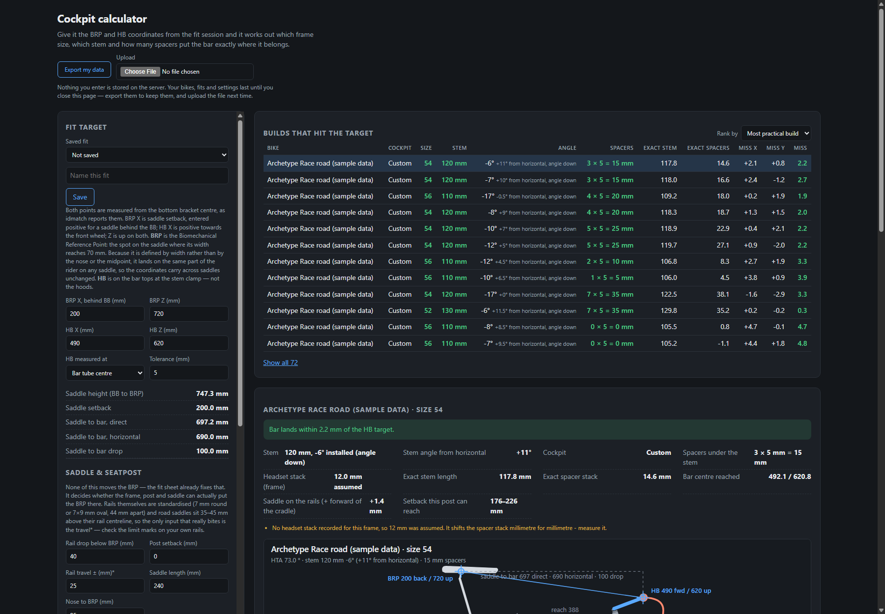

> **Disclaimer.** This project is vibe coded: it was written with an AI assistant and has not had a
> formal code review or test pass. All geometry data it contains or imports (bike frames, cockpit
> presets, saddle figures) is **not validated** — it may be wrong, outdated or mis-transcribed.
> Check every figure against the manufacturer and your fitter before ordering parts or changing
> your bike setup, and use the results at your own risk.

# BikeGeo — cockpit calculator



## What it does

An ASP.NET Core (.NET 10) Blazor Server app that turns a bike-fit result into a build sheet: which
frame size, which stem, and how many spacers put the handlebar exactly where the fit says it
belongs — plus a scaled drawing of the bike and a detail drawing of the cockpit.

It is built around the output of [IdMatch](https://www.idmatch.cc/), the bike-fit service that
produces the saddle (BRP) and handlebar (HB) coordinates. Enter those, pick or add bikes and
cockpits, and get a ranked list of builds that hit the target. BikeGeo is an independent project
and is not affiliated with IdMatch.

## How to run it

With the .NET 10 SDK:

```bash
dotnet run --project BikeFit.Web/BikeFit.Web.csproj
```

Or with Docker:

```bash
docker run --rm -p 8080:8080 kvloover/bikegeo:latest
```

then open <http://localhost:8080>.

## More

See the [documentation](docs/README.md) for inputs, how the solver works, importing geometry,
hosting and releases.

## License

[MIT](LICENSE) — free to use, copy, modify, merge, publish and distribute, with no warranty.
